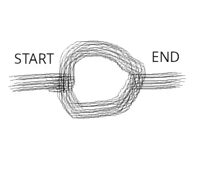

# search_seq_including_spaces
## Summary


- Narrowly, Find sequences including nucleotide(or amino acid) spaces and Output the results to every csv file.
- Broadly, you can find the speific sequences of front and back while ignoring the middle sequences)
- Language: Python (CI-tested on 3.10–3.14)
>__Note__ You can confirm for Bioinformatics Tips at Wiki.


[](https://github.com/myon-bioinformatics/search_seq_including_spaces/actions/workflows/tests.yml)

[](https://github.com/myon-bioinformatics)
[](https://www.reddit.com/user/myon_reddit/)
[](https://twitter.com/myonitbusiness)


## Search, summarize and analyze

Runtime remains standard-library only. [Roadmap tools and contracts](docs/ROADMAP_TOOLS.md)
cover the new CLI, limits, coordinate semantics and optional adapters.

```sh
python -S sequence_tool.py match input.fa --left AC --right GT --min-gap 1 --jsonl
python -S sequence_tool.py candidates input.fa --mode pairwise --seed 42 --limit 1000
python -S sequence_tool.py summarize-hits hits.csv --gap-merge 10000 --top 10
python -S sequence_tool.py compare a.fa b.fa --alphabet dna --window 21 --summary
python -S sequence_tool.py nucleotide-features input.fa --alphabet dna --jsonl
python -S sequence_tool.py translate input.fa --frame 0 --strand + --jsonl
python -S sequence_tool.py rna-fold input.fa --jsonl
```

Also available: JSON pattern packs; JSON/JSONL and GenBank ORIGIN readers;
FASTA/FASTQ/text chunk search; poly-A/TSD/SNP/STR clues; pH charge/pI;
preprocessing with receipts and MEGA export; NCBI acquisition; PDB/mmCIF
geometry; bounded HTTP/MCP adapters and an optional Jev routing boundary.
External services, scientific model quality and Docker deployment need their
own operational validation. FASTA↔TSV conversion remains out of scope.

## Protein sequence tools (in development)
Standard library only. CI-tested on Python 3.10–3.14. Values are sequence-derived hints, not structure.

```sh
python sequence_tool.py fasta validate in.fasta
python sequence_tool.py protein features in.fasta            # JSON (protein-hints/1)
python sequence_tool.py protein profile in.fasta --window 9  # per-residue TSV (or --json / --jsonl)
python sequence_tool.py protein roi in.fasta --ascii         # regions of interest (heuristic)
```

Ambiguity codes B/Z/J/X are excluded by default (`--ambiguity mean-of-candidates` to opt in). Exit code 2 means an input error. Details, thresholds and limitations: [docs/PROTEIN.md](docs/PROTEIN.md).

## Streaming sequence readers

`sequence_readers.read_sequences()` yields common `SequenceRecord` values from
FASTA, FASTQ, plain text, CSV, TSV, JSON, JSONL and the GenBank ORIGIN subset, including
gzip/bz2/xz/lzma paths (CSV/TSV need an explicit sequence column). Runtime is
stdlib-only. Contract, detection rules, supported subset and migration map:
[docs/SEQUENCE_READERS.md](docs/SEQUENCE_READERS.md).

## Aligned sequence comparison

The stdlib-only comparison tools accept already-aligned DNA, RNA, or protein
pairs. They do not perform alignment or infer homology.

```sh
python -S sequence_tool.py compare a.fasta b.fasta --alphabet dna
python -S sequence_tool.py compare a.fasta b.fasta --alphabet dna --window 21 --step 5
python -S sequence_tool.py compare a.fasta b.fasta --alphabet protein --ascii --width 60
```

S1 reports exact identity and comparison coverage. S2 adds sliding-window
identity/local divergence and an ASCII aligned diff while preserving the same
gap and ambiguity policies. Details and scientific boundaries:
[docs/COMPARISON.md](docs/COMPARISON.md).

## SEARCH_SEQUENCE_IMAGE


## References
- About Nucleotides:https://www.ncbi.nlm.nih.gov/nuccore/
- About amino-acid: https://www.ncbi.nlm.nih.gov/protein/


## Test evidence

The stdlib [anchor/gap matcher](docs/ANCHOR_MATCHER.md) supports exact/ranged
gaps, coordinate-preserving normalization, IUPAC DNA compatibility and reverse
search as a separate importable module.

Install test-only tools with `python -m pip install -r tests/requirements.txt`.
CI preserves native pytest JSONL and JUnit while retaining the `python -S`
runtime isolation lane. See [recording and exploration](docs/pytest-observations.md).

## Runtime and development Python policy

The standard-library runtime supports Python 3.10+; this change preserves the
existing runtime floor. The separate `runtime-compatibility` CI lane executes
behavior tests with `python -S`, without installing pytest or any third-party
package. Development/test environments use Python 3.11+ and a committed uv lock:

```sh
uv sync --locked --python 3.11
uv run --locked python -m pytest
python -S -m unittest discover -s tests -p test_sequence_readers.py -v
```

`pyproject.toml` is the canonical development dependency definition; legacy
requirements files remain for downstream callers. Runtime metadata does not
raise the source/vendoring floor to the development floor. CI pins setup-python
v7.0.0 and setup-uv v10.3.0 by full commit SHA, and uses uv 0.13.1. Setup actions
using Node 24 require runner 2.327.1 or newer (GitHub-hosted runners are used).
